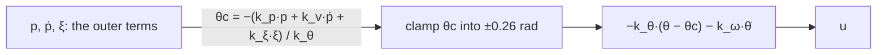

# `demand_lim`: a cascade limit inside one gain

A state-feedback gain acts on every state at once. A cascade of loops has a point between them, the setpoint the outer loop hands the inner one, where a limit goes: the lean a balancing robot's position loop may ask for, the speed a position loop may ask of a drive. One LQ gain has no such point. `demand_lim` reads one inside it and clamps it. This note derives the construction, what it does to the loop, what it costs, and what it does not guarantee.

## The cascade inside a gain

An LQ law is

```math
u = u^* - K z, \qquad z = \begin{bmatrix} x - x^* \\ \xi \end{bmatrix},
```

the deviation of the state from the reference point, then the integrators. Pick one plant state s, and split the other terms into two sets: the outer terms O, which are to ask for s, and the rest R. Row i of the law is

```math
u_i = -K_{is}\, z_s \;-\; \sum_{j \in O} K_{ij}\, z_j \;-\; \sum_{j \in R} K_{ij}\, z_j .
```

Where $`K_{is} \neq 0`$, take $`K_{is}`$ out of the first two sums:

```math
u_i = -K_{is}\,\bigl(z_s - z_{c,i}\bigr) \;-\; \sum_{j \in R} K_{ij}\, z_j, \qquad z_{c,i} = -\frac{\sum_{j \in O} K_{ij}\, z_j}{K_{is}} .
```

This is an identity, not an approximation: the same law, written as an inner loop on s with gain $`K_{is}`$ tracking the setpoint $`z_{c,i}`$ that the outer terms produce. The terms in R act inside the inner loop (a rate term is its damping). Each input has its own row and so its own setpoint; an input with no gain on s has none.

## The clamp

`demand_lim` clamps that setpoint into an interval $`[\ell_-, \ell_+]`$, a deviation of s from its reference:

```math
u_i' = -K_{is}\,\bigl(z_s - \operatorname{sat}(z_{c,i})\bigr) \;-\; \sum_{j \in R} K_{ij}\, z_j
     \;=\; u_i + K_{is}\,\bigl(\operatorname{sat}(z_{c,i}) - z_{c,i}\bigr).
```

Inside the interval $`u' = u`$: the law is the LQ law, exactly. Outside it, only the outer terms' share of the command is bounded, at $`K_{is}\,\ell_\pm`$. The gain on s and the terms in R keep their full stiffness, so the inner loop is as strong as ever while its setpoint is held.

With K split by columns into $`K_{\text{out}}`$ (the columns in O) and $`K_{\text{in}} = K - K_{\text{out}}`$, and $`k_s`$ the column on s, the law is piecewise linear:

```math
u = u^* - K_{\text{in}}\, z + k_s \circ \operatorname{sat}\!\left(\frac{-K_{\text{out}}\, z}{k_s}\right),
```

entry by entry over the inputs.

## Example: a balancing robot

The state is $`x = [p,\ \dot p,\ \theta,\ \dot\theta]`$, with an integrator ξ on the position error, and the gain one row $`K = [k_p,\ k_v,\ k_\theta,\ k_\omega,\ k_\xi]`$. Take the lean θ as s, and position, speed and ξ as the outer terms, listed by index (the plant states 0 to 3, then the integrator, 4), a `DemandLimit` among the design's options:

```cpp
DemandLimit{.state = 2, .outer = {0, 1, 4}, .lim = {.lower = -0.26, .upper = 0.26}}
```



A position error that asks for a lean of 0.5 rad gets 0.26. The robot drives back at the lean it can hold; the lean loop, $`k_\theta`$ and $`k_\omega`$, stays as stiff as the design made it.

## On the tick

The runtime computes $`u^* - K z`$ as ever, a plain product with the gain. The clamp corrects it afterwards ([`limit_demand`](../inc/damp/controllers/detail/state_feedback_core.hpp)): per input i, it forms the outer terms' share $`o_i = -\sum_{j \in O} K_{ij} z_j`$ again, takes $`z_{c,i} = o_i / K_{is}`$, and where the clamp changes it adds $`K_{is}\operatorname{sat}(z_{c,i}) - o_i`$ to $`u_i`$. K itself never changes. An input whose gain on s is rounding, $`|K_{is}| \le 4\varepsilon`$ times its row's largest gain, is left as it is. Then the command is clamped into `u_lim`.

Off, the limit costs one comparison per tick. On, it costs a second pass over each row of K, $`N_U (N_X + N_I)`$ multiply-adds, and $`N_U`$ divisions. A `Law<kRes>` of a `constexpr` design holds the limit as a constant of the type.

## The integrators

While the clamp holds the setpoint, the outer terms' share of the command no longer grows with them. An integrator among the outer terms would keep integrating a contribution that is thrown away, and unwind it later, with the overshoot of any windup. The law records the command before the clamp; at the next predict, integrator $`\xi_i`$ holds when integrating its error $`e_i`$ would push a clamped input j further into its clamp, $`K_{j,\xi_i}\, e_i\, (u_j^{\text{applied}} - u_j^{\text{asked}}) > 0`$ (conditional integration, the default). With a `tracking_time` $`T_t`$ in the `IntegralAction` they integrate as ever and move by $`\min(T_s/T_t, 1)\,(\partial u/\partial\xi)^{+}(u^{\text{applied}} - u^{\text{asked}})`$ instead (back-calculation). The same rule covers `u_lim` and a clamp reported with `back_calculate`.

## Steady state

At the reference, $`z = 0`$, the setpoint asked of s is 0, inside any interval that contains 0: the reference is still an equilibrium. Under a constant disturbance the integrators settle at the value that cancels it, and through the outer columns that value can ask for a lean. A robot holding position on a slope needs one. If the lean it needs is outside the interval, the clamped loop cannot reach the equilibrium: it holds the plant short of its reference. The interval has to contain what the outer terms must carry at a steady state.

## What the clamp does to the loop

Write the saturation as the identity less a dead zone, $`\operatorname{sat}(v) = v - \operatorname{dz}(v)`$, with $`v = -K_{\text{out}} z / k_s`$ entry by entry. The clamped law is the linear one less a dead-zone term:

```math
u = u^* - K z - k_s \circ \operatorname{dz}(v).
```

The closed loop is the LQ closed loop $`A_{\text{cl}} = A - BK`$ with the dead zone fed back through $`-B\operatorname{diag}(k_s)`$:

```math
z_{k+1} = A_{\text{cl}}\, z_k - B \operatorname{diag}(k_s)\, \operatorname{dz}(C_v z_k), \qquad C_v = -\operatorname{diag}(k_s)^{-1} K_{\text{out}} .
```

That is a Lur'e system: a linear loop with a static nonlinearity in feedback. The dead zone's slope $`\operatorname{dz}(v)/v`$ lies in $`[0, 1)`$. At slope 0 the loop is the LQ design, stable with the margins the design gives it. As the slope goes to 1 (a setpoint far past the limit), $`\operatorname{dz}(v) \to v - \ell_\pm`$ and the outer terms' feedback is replaced by the constant $`K_{is}\,\ell_\pm`$: the plant runs under the inner terms alone, pushed by a bounded force toward the reference.

## Stability

While the clamp does not bind, the loop is the LQ loop, and the design's guarantees hold. While it binds, the gain was never designed for it: the Riccati equation saw no saturation. Nothing in the design certifies the clamped loop, and two things are known.

A global certificate of the usual kind cannot exist for the cases `demand_lim` is for. The circle criterion over the sector $`[0, 1]`$, or any quadratic Lyapunov function certified against it, proves the loop stable for every slope in that sector, the slope-1 loop with the outer feedback removed among them. On a balancing robot that loop has no feedback on position: the position mode is an integrator, marginally stable, and the certificate fails. It fails because the test asks for too much, not necessarily because the robot diverges: with the lean bounded but kept, the outer terms still push it back. Whether they always bring it back is not settled by a sector test.

A regional certificate can exist. Where $`|v_i| \le \bar v`$, the dead zone's slope is at most $`\sigma = 1 - \ell / \bar v`$, with $`\ell = \min(-\ell_-, \ell_+)`$, so inside that region the loop never loses more than the fraction σ of its outer feedback. The generalized sector condition then gives a level set of a quadratic Lyapunov function inside which every trajectory converges. With the design's own Riccati solution S as that function, for one input acting on s, the S-procedure multiplier can be eliminated in closed form. With $`M = S - A_{\text{cl}}^{\mathsf T} S A_{\text{cl}}`$ (the LQ stage cost on the closed loop, $`M \succ 0`$ when it is positive definite), $`b = -A_{\text{cl}}^{\mathsf T} S B k_s`$, $`c = C_v^{\mathsf T}`$, and

```math
c_0 = k_s^2\, B^{\mathsf T} S B + b^{\mathsf T} M^{-1} b, \qquad \beta = c^{\mathsf T} M^{-1} b, \qquad c_2 = c^{\mathsf T} M^{-1} c,
```

the Lyapunov difference of $`V = z^{\mathsf T} S z`$ is negative for every dead-zone slope up to

```math
\sigma_{\max} = \frac{1}{\beta + \sqrt{c_0\, c_2}} .
```

Then $`\bar v = \ell / (1 - \sigma_{\max})`$, and the largest level set inside $`|C_v z| \le \bar v`$,

```math
\mathcal{E} = \{\, z : z^{\mathsf T} S z \le c^\star \,\}, \qquad c^\star = \frac{\bar v^{\,2}}{C_v S^{-1} C_v^{\mathsf T}},
```

is invariant, and every trajectory that starts in it converges to the reference. A $`\sigma_{\max} \ge 1`$ would certify the clamp globally. Damp does not compute this yet. Its limits: S is not chosen for the clamped loop, so the true region of attraction is larger than $`\mathcal{E}`$; with several inputs acting on s the closed form needs one multiplier shared between them, more conservative still, and an LMI otherwise; and the integrators' hold or back-calculation and `u_lim` are other nonlinearities, outside the model as written.

## The input limit is a different clamp

`demand_lim` bounds a setpoint; `u_lim` bounds the command. On a plant with a mode that is unstable on its own, a command on its limit is the worse failure: the inner terms, the only feedback that stabilizes that mode, are cut along with the rest, and the mode can run away. `demand_lim` makes that rarer, because the outer terms ask for less, but it does not keep the command inside `u_lim`: the inner terms alone can still exceed it.

Glattfelder & Schaufelberger (2005) meet the same failure on an inverted pendulum driven by an electro-hydraulic actuator, and trace it to the inclination references the speed loop asks for. They keep the command off the actuator's limits by override control. The command is made a second controlled variable, to be held inside a band a margin short of the actuator's limits. A second controller regulates it at the band's edge, and min/max selectors pass whichever command is the more restrictive. Each path closes its own inclination loop, so a stabilizing loop is always closed, and with the margin the actuator never reaches its stops. They show that this widens the region the loop recovers from, where anti-windup alone cannot.

## Related work

Each part of the construction is published; the combination, one finished optimal gain read as a cascade and clamped per input with the integrators held against it, was not found in the work below.

| Work | What it does | How it differs |
| --- | --- | --- |
| Glattfelder & Schaufelberger, [*Antiwindup and override control for exponentially unstable systems with actuator constraints*](https://skoge.folk.ntnu.no/prost/proceedings/ifac2005/Fullpapers/02398.pdf), 16th IFAC World Congress, 2005 | Reads a pole-placed state feedback with integral action on an inverted pendulum as the equivalent cascade, speed → inclination → actuator (§4), and traces the loss of stability to excessive inclination references from the speed controller (§5.1). Certified with the circle and Popov tests | Bounds the actuator signal with override selectors; does not clamp the inclination reference |
| Ghignoni, Invernizzi & Lovera, [*Fixed-dynamics antiwindup design: application to pitch-limited position control of multirotor UAVs*](https://re.public.polimi.it/handle/11311/1156321), IEEE Trans. Control Systems Technology, 2021 | Saturates the pitch setpoint a multirotor's outer position loop asks for, with an anti-windup compensator synthesized on generalized sector conditions, for open-loop unstable plants | An explicit cascade of separate loops, and a synthesized compensator in place of conditional integration |
| Teel, *Global stabilization and restricted tracking for multiple integrators with bounded controls*, Systems & Control Letters 18(3), 1992 | Nested saturations: clamps the intermediate control of a chain of integrators, with gains chosen so the saturated loop is globally stable | The saturations are part of the design, and the law is not an optimal gain |
| Tarbouriech, Prieur & Gomes da Silva, *Stability analysis and stabilization of systems presenting nested saturations*, IEEE TAC 51(8), 2006 | Treats saturations inside a feedback as dead zones, with a generalized sector condition and LMIs for a region of attraction | The analysis a certificate of `demand_lim` would use; no cascade reading of a gain |
| Farrell, Polycarpou, Sharma & Dong, *Command filtered backstepping*, IEEE TAC 54(6), 2009 | Limits the magnitude of virtual controls (commanded intermediate states) in backstepping, with compensated tracking errors | Nonlinear backstepping, designed with the limits |
| Garone, Di Cairano & Kolmanovsky, *Reference and command governors for systems with constraints*, Automatica 75, 2017 | Shapes the external reference of a stabilized loop so state constraints hold, with a guarantee | Acts on the reference outside the law, not on a setpoint inside the gain |

A bound on the state itself, with a guarantee, is `design::mpc`'s `x_lim` or an `ActionGovernor` around the law. `demand_lim` bounds what the outer terms ask, which no law without a prediction can turn into a bound on the state.
