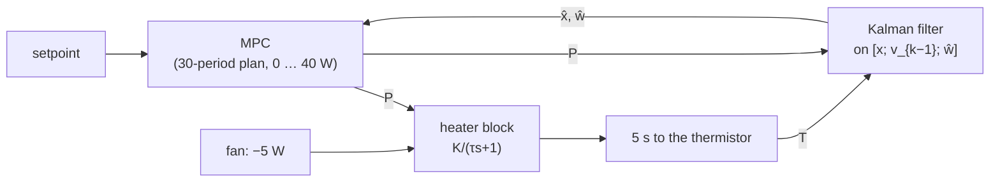

# Heater with dead time — offset-free MPC, the delay predicted

Read this before forking the sketch. Numbers here match [`heater_ofmpc_controller.hpp`](heater_ofmpc_controller.hpp) and [`heater_ofmpc_sil.cpp`](heater_ofmpc_sil.cpp).

**What you are looking at.** A 3D-printer hotend: a 40 W heater cartridge in an aluminium block, read by a thermistor. Heat takes about 5 s to travel from the cartridge to the thermistor, and the controller runs every 2 s, so the thermistor reports what the heater did two and a half periods ago. The controller is an offset-free MPC that predicts through that delay. The SIL runs it next to the same MPC designed without the delay, on the same hotend.

---

## The plant: first order plus dead time

Most thermal processes look like a first-order lag behind a pure delay (FOPDT). In degrees above ambient, $`x = T - T_{\mathrm{amb}}`$, with heater power $`P`$:

```math
\tau\,\dot x(t) = -x(t) + K\,P(t-\theta), \qquad G(s) = \frac{K\,e^{-\theta s}}{\tau s + 1}
```

| What | Code | Value | Plain meaning |
| ---- | ---- | ----- | ------------- |
| $`K`$ | `kGain` | 6 °C/W | Steady temperature rise per watt |
| $`\tau`$ | `kTau` | 30 s | How fast the block warms (63 % of a step) |
| $`\theta`$ | `kDeadTime` | 5 s | Heater → thermistor delay |
| $`P_{\max}`$ | `kPmax` | 40 W | Cartridge at full duty; the heater cannot cool |
| $`T_{\mathrm{amb}}`$ | `kAmbient` | 25 °C | Ambient the controller assumes (the SIL's room is 22 °C) |
| $`T_s`$ | `kTs` | 2 s | Control period, so $`\theta = 2.5\,T_s`$ |

Three numbers are enough to fit one from a single open-loop step test: the final rise per watt is $`K`$, the time before anything moves is $`\theta`$, and the time to 63 % after that is $`\tau`$.

---

## Why the delay is predicted

A controller that does not know about the delay sees the temperature still low and keeps heating, although the heat that will close the gap is already in the block. It overshoots, and when it is pushed hard it oscillates: the SIL's no-delay design overshoots by 7.7 °C on the way up and, after the fan disturbance, settles into a 13 °C limit cycle.

The whole design and runtime:

```cpp
constexpr auto kLaw = design::mpc<30, 10, kDeadTime / kTs>(kPlant, kTs, weights, limits, noise);  // 5 s at 2 s: 2.5 periods
static constinit OffsetFreeMPC controller{kLaw.as<float>()};  // sizes and the delay from the design; a failed design does not compile
```

Write the dead time as $`\theta = d\,T_s + \tau_f`$, here $`d = 2`$ periods and $`\tau_f = 1`$ s. The whole periods never enter the model. The controller keeps the $`d`$ powers it has already sent and, each period, predicts where the block will be when the power it decides now arrives,

```math
x_{k+d} = A^d x_k + \sum_{j=0}^{d-1} A^{d-1-j} B\,u_{k-d+j},
```

and plans from there (`InputDelayPredictor`, inside `OffsetFreeMPC`). The remaining second stays in the model, with no approximation: within each period the block sees the previous command for the first second and the current one for the rest, so with $`a = e^{-T_s/\tau}`$ and $`v`$ the command stream delayed by the $`d`$ whole periods,

```math
x_{k+1} = a\,x_k + \Gamma_0\,v_k + \Gamma_1\,v_{k-1},\qquad
\Gamma_0 = K\bigl(1 - e^{-(T_s-\tau_f)/\tau}\bigr),\quad
\Gamma_1 = K\,e^{-(T_s-\tau_f)/\tau}\bigl(1 - e^{-\tau_f/\tau}\bigr)
```

The previous command $`v_{k-1}`$ is one register state, $`[x_k;\ v_{k-1}]`$; it is not a guess, the controller sent it, so it carries no process noise. A Padé approximation would instead add a non-minimum-phase zero that is only right at low frequency.

This is Artstein's reduction, the Smith predictor in state space: the same law as a model with every past power as a state (the register form, `discretize(…, InputDelay<3>{θ})`), at two states instead of four, and at one state instead of fifty-one for a 5 ms delay on a 10 kHz loop. `tests/test_delay_predictor.cpp` shows the two forms give the same commands. The register form stays for designs that need the delay inside the model, such as OFLQG trajectory tracking.

---

## Offset-free MPC

The MPC predicts the temperature over the next 30 periods (60 s, two time constants) on that model, and picks the next ten power moves that keep the temperature on the setpoint without jerking the heater, subject to $`0 \le P \le P_{\max}`$. Only the first move is applied; next period it plans again from the new measurement.

The rate weight `Rdu = 10` is not cosmetic. With $`\tau_f \approx T_s/2`$ the two input gains are nearly equal, $`\Gamma_1 \approx \Gamma_0`$, which puts a sampling zero of the discrete model at $`z \approx -\Gamma_1/\Gamma_0 \approx -0.97`$. A cheap rate penalty lets the optimizer push on that zero, and the power then alternates up and down every period for a few periods after any disturbance (5 W swings with `Rdu = 0.02` on this plant). At 10 it comes off the clamp and lands in two periods. The heat-up is unaffected either way: the 40 W clamp decides it.

A model is never exact: the room is colder than assumed, and a part-cooling fan switches on halfway through and takes 5 W that nobody measures. A plain MPC would settle with a steady error. The offset-free form adds a disturbance $`w`$ to the model, entering like the heater power, and lets a Kalman filter estimate it along with the state:

```math
x_{k+1} = A x_k + B (P_k + w_k),\qquad w_{k+1} = w_k
```

The MPC then plans with $`\hat w`$: if the block runs 5 W short, it asks for 5 W more. At steady state the measured temperature must equal the prediction, so the error goes to zero whatever the true loss is. The filter's noise settings say how much to trust the model (0.01 °C² per period), how fast the loss may drift (0.05 W² per period) and how noisy the thermistor is (σ = 0.1 °C).



Tick in code: `heater_period(controller, setpoint, temperature)`, the same function in the sketch and the SIL.

---

## Preview: the setpoint known ahead

MATLAB's MPC block takes the reference as a sequence over the horizon, and so does this one: `heater_period(mpc, setpoint_ahead, temperature)` hands in the next 30 periods of the setpoint profile (`SetpointAhead`), and the single-setpoint tick is the same call with the value repeated. A print job knows its temperature profile, so the controller can be told about a change before it happens.

The SIL runs the profile 210 °C → 190 °C at 360 s twice with the same delay-aware MPC: told 60 s ahead, and holding the current setpoint. The heater cannot cool, so after a step down all it can do is switch off and wait for the block to lose heat through the fan; told ahead, it switches off early enough that the temperature crosses 190 °C close to the moment the setpoint does.

| | ∫\|e\| dt over 300 … 480 s |
| --- | --- |
| Setpoint known 60 s ahead | 22 °C·s |
| Setpoint held | 152 °C·s |

The control horizon matters once the plan looks ahead. With four moves and a held tail, the optimizer's best plan for a step 40 s out was to bank 3 °C before it so the lowered tail could coast, which is what a short control horizon does with preview; ten moves (`kMoves`) remove it (a 1.3 °C bump right before the step remains, the optimal trade under the quadratic cost). Plot: `plots/control/heater_ofmpc_preview.html`. The SIL fails if preview does not cut the error to under a third, or if the loop does not land on 190 °C.

## What the SIL shows

| Time | What happens |
| ---- | ------------ |
| 0 s | Cold start (22 °C), setpoint 210 °C |
| 240 s | Part-cooling fan on: an unmeasured 5 W heat loss |
| 480 s | End |

| | Heat-up overshoot | Worst error after the fan | Last minute | Power |
| --- | --- | --- | --- | --- |
| MPC on the delayed model | 0.18 °C | 5.4 °C | 0.00 °C | 30.9 … 40 W |
| Same MPC, delay ignored | 7.3 °C | 13.2 °C | 13.1 °C (limit cycle) | 0 … 40 W |

The plot samples the plant every 0.2 s (ten points per control period) and draws the power as the steps it is held at. The 5 °C dip when the fan starts is physics: the fan cools the block at 1 °C/s, and nothing the heater does reaches the thermistor for 5 s. The SIL fails if the delay-aware law leaves an offset, if either law leaves 0 … 40 W, or if ignoring the delay is not clearly worse; the profile run adds its own checks above.

The limit cycle is not an MPC trait: the same offset-free LQG designed without the delay falls into a 12.7 °C cycle swinging the full 40 W, and with its input weight raised a hundredfold it still carries a 5.7 °C error. Any law tuned for the 30 s time constant and blind to 2.5 periods of dead time does this. The unconstrained law the MPC reduces to, an offset-free LQG clamped at the actuator, is [`../heater_oflqg/`](../heater_oflqg/heater_oflqg_derivation.md); on this plant it matches the MPC, since only full power during the heat-up ever binds.

---

## Forking it

- Measure $`K`$, $`\tau`$ and $`\theta`$ from one open-loop step and put them in the nameplate, and the design takes the dead time in periods, `kDeadTime / kTs`. Keep $`T_s`$ well below $`\tau`$ (a tenth or less); the dead time can be any multiple of it, and the model stays two states.
- Raise `Rdu` for gentler power moves, lower it for a faster loop. Below about 2 on this plant the power starts to alternate at the control rate after a disturbance (the sampling zero near z = −1 above); the delay-blind design is what rings in the temperature.
- The MPC and filter are designed at compile time (`kLaw`), so the board only runs the tick; the sketch's controller is `constinit`, so a failed design is a compile error. The unconstrained law, [`../heater_oflqg/`](../heater_oflqg/heater_oflqg_derivation.md), is designed the same way; flash it instead of the MPC when the only constraint is the actuator's own range.
