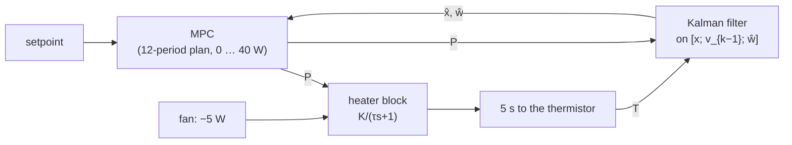

# Heater with dead time — offset-free MPC, the dead time in one sample

Read this before forking the sketch. Numbers here match [`heater_ofmpc_controller.hpp`](heater_ofmpc_controller.hpp) and [`heater_ofmpc_sil.cpp`](heater_ofmpc_sil.cpp).

**What you are looking at.** A 3D-printer hotend: a 40 W heater cartridge in an aluminium block, read by a thermistor. Heat takes about 5 s to travel from the cartridge to the thermistor, and the controller runs every 5 s, so the thermistor reports what the heater did one period ago. The controller is an offset-free MPC with that period of delay in its model. The SIL runs it next to the same MPC designed without the delay, on the same hotend.

---

## The plant: first order plus dead time

Most thermal processes look like a first-order lag behind a pure delay (FOPDT). In degrees above ambient, $`x = T - T_{\mathrm{amb}}`$, with heater power $`P`$:

```math
\tau\,\dot x(t) = -x(t) + K\,P(t-\theta), \qquad G(s) = \frac{K\,e^{-\theta s}}{\tau s + 1}
```

| What | Code | Value | Plain meaning |
| ---- | ---- | ----- | ------------- |
| $`K`$ | `kGain` | 6 °C/W | Steady temperature rise per watt |
| $`\tau`$ | `kTau` | 30 s | How fast the block warms (63 % of a step) |
| $`\theta`$ | `kDeadTime` | 5 s | Heater → thermistor delay |
| $`P_{\max}`$ | `kPmax` | 40 W | Cartridge at full duty; the heater cannot cool |
| $`T_{\mathrm{amb}}`$ | `kAmbient` | 25 °C | Ambient the controller assumes (the SIL's room is 22 °C) |
| $`T_s`$ | `kTs` | 5 s | Control period, so $`\theta = T_s`$ |

Three numbers are enough to fit one from a single open-loop step test: the final rise per watt is $`K`$, the time before anything moves is $`\theta`$, and the time to 63 % after that is $`\tau`$.

---

## Why the delay is in the model

A controller that does not know about the delay sees the temperature still low and keeps heating, although the heat that will close the gap is already in the block. It overshoots, and when it is pushed hard it oscillates: the SIL's no-delay design overshoots by 10 °C on the way up and is still 6.1 °C off in the last minute after the fan disturbance.

The whole design and runtime:

```cpp
constexpr auto kModel = *discretize(kPlant, kTs, InputDelay{kDeadTime});  // 5 s at 5 s: one period, one register state
constexpr auto kLaw = design::ofmpc<12, 4>(kModel, kWeights, kLimits, kNoise, design::InputDisturbance{});
static constinit Law<kLaw, float> controller;  // the design's OFMPC: sizes, estimator and delay from the design, the filter on constants; a failed design does not compile
```

After the weights come, in this order, the limits, the estimator's noise (`KalmanNoise`, so the controller runs from the thermistor reading through a Kalman filter) and the disturbance model (`InputDisturbance`, which makes it offset-free): `design::ofmpc<NP, NC>(model, weights, limits, noise, disturbance)`, run as `OFMPC`, whose tick is `step(r, y)`. The dead time is in the model itself.

The dead time is one control period, $`\theta = T_s`$, so the power decided now reaches the block only over the next period. The model carries the previous command as one register state, with no approximation: with $`a = e^{-T_s/\tau}`$,

```math
x_{k+1} = a\,x_k + \Gamma_1\,v_{k-1},\qquad \Gamma_1 = K\,(1 - a),
```

and the command $`v_k`$ loads the register, $`[x_k;\ v_{k-1}]`$. A dead time shorter than the period, $`0 < \theta < T_s`$, is exact too: within each period the block sees the previous command for $`\theta`$ and the current one for the rest,

```math
x_{k+1} = a\,x_k + \Gamma_0\,v_k + \Gamma_1\,v_{k-1},\qquad
\Gamma_0 = K\bigl(1 - e^{-(T_s-\theta)/\tau}\bigr),\quad
\Gamma_1 = K\,e^{-(T_s-\theta)/\tau}\bigl(1 - e^{-\theta/\tau}\bigr)
```

The register is not a guess, the controller sent it, so it carries no process noise. A Padé approximation would instead add a non-minimum-phase zero that is only right at low frequency.

A longer dead time means more registers, `InputDelay<N>{θ}`, or sampling slower, as here: 5 s is six samples per 30 s time constant, plenty for a thermal plant, and the model stays small. A single loop whose dead time spans many samples is a job for `SmithPredictor`.

---

## Offset-free MPC

The MPC predicts the temperature over the next 12 periods (60 s, two time constants) on that model, and picks the next four power moves that keep the temperature on the setpoint without jerking the heater, subject to $`0 \le P \le P_{\max}`$. Only the first move is applied; next period it plans again from the new measurement.

The model is discrete, so the weights are per period: `Qy = 1` on each sampled temperature error and `Rdu = 1.6` on each power change, the per-second weights `Qy = 1` and `Rdu = 40` of a continuous cost over the 5 s period.

A model is never exact: the room is colder than assumed, and a part-cooling fan switches on halfway through and takes 5 W that nobody measures. A plain MPC would settle with a steady error. The offset-free form (`design::InputDisturbance`) adds a disturbance $`w`$ to the model, entering like the heater power, and lets a Kalman filter estimate it along with the state:

```math
x_{k+1} = A x_k + B (P_k + w_k),\qquad w_{k+1} = w_k
```

The MPC then plans with $`\hat w`$: if the block runs 5 W short, it asks for 5 W more. At steady state the measured temperature must equal the prediction, so the error goes to zero whatever the true loss is. The filter's noise settings say how much to trust the model (0.05 °C² per period), how fast the loss may drift (0.25 W² per period) and how noisy the thermistor is (σ = 0.1 °C per reading). The first two are 0.01 °C²/s and 0.05 W²/s over the 5 s period; the third is the variance of one reading, used as is.



Tick in code: `heater_period(controller, setpoint, temperature)`, the same function in the sketch and the SIL.

---

## Preview: the setpoint known ahead

MATLAB's MPC block takes the reference as a sequence over the horizon, and so does this one: `heater_period(mpc, setpoint_ahead, temperature)` hands in the next 12 periods of the setpoint profile (`SetpointAhead`), and the single-setpoint tick is the same call with the value repeated. A print job knows its temperature profile, so the controller can be told about a change before it happens.

The SIL runs the profile 210 °C → 190 °C at 360 s twice with the same delay-aware MPC: told 60 s ahead, and holding the current setpoint. The heater cannot cool, so after a step down all it can do is switch off and wait for the block to lose heat through the fan; told ahead, it switches off early enough that the temperature crosses 190 °C close to the moment the setpoint does.

| | ∫\|e\| dt over 300 … 480 s |
| --- | --- |
| Setpoint known 60 s ahead | 2 °C·s |
| Setpoint held | 202 °C·s |

The control horizon matters once the plan looks ahead: with too few moves and a held tail, the optimizer banks heat before a step down so the lowered tail can coast, which is what a short control horizon does with preview. Four moves of 5 s, 20 s of the 60 s plan, give it room. Plot: `plots/control/heater_ofmpc_preview.html`. The SIL fails if preview does not cut the error to under a third, or if the loop does not land on 190 °C.

## What the SIL shows

| Time | What happens |
| ---- | ------------ |
| 0 s | Cold start (22 °C), setpoint 210 °C |
| 240 s | Part-cooling fan on: an unmeasured 5 W heat loss |
| 480 s | End |

| | Heat-up overshoot | Worst error after the fan | Last minute | Power |
| --- | --- | --- | --- | --- |
| MPC on the delayed model | 0.03 °C | 8.5 °C | 0.00 °C | 31.3 … 40 W |
| Same MPC, delay ignored | 10.1 °C | 8.8 °C | 6.1 °C | 18.8 … 40 W |

The plot samples the plant every 0.2 s (25 points per control period) and draws the power as the steps it is held at. The 5 °C dip when the fan starts is physics: the fan cools the block at 1 °C/s, and nothing the heater does reaches the thermistor for 5 s. The SIL fails if the delay-aware law leaves an offset, if either law leaves 0 … 40 W, or if ignoring the delay is not clearly worse; the profile run adds its own checks above.

The ringing is not an MPC trait: any law tuned for the 30 s time constant and blind to the period of dead time does this. The unconstrained law the MPC reduces to, an offset-free LQG clamped at the actuator, is [`../heater_lqg/`](../heater_lqg/heater_lqg_derivation.md); on this plant it matches the MPC, since only full power during the heat-up ever binds.

---

## Forking it

- Measure $`K`$, $`\tau`$ and $`\theta`$ from one open-loop step and put them in the nameplate, and the model takes the dead time in seconds, `discretize(kPlant, kTs, InputDelay{kDeadTime})`. Keep $`T_s`$ at or above the dead time and well below $`\tau`$, here 5 s against 30 s, and the model stays two states. A dead time longer than that takes `InputDelay<N>` and N more states per input, or, for a single loop spanning many samples, `SmithPredictor`.
- Raise `Rdu` for gentler power moves, lower it for a faster loop. The weights are per period, so a different `kTs` needs them rescaled (and the horizons in periods rescaled to the same seconds); the delay-blind design is what rings in the temperature.
- The MPC and filter are designed at compile time (`kLaw`), so the board only runs the tick; the sketch's controller is `constinit`, so a failed design is a compile error. The unconstrained law, [`../heater_lqg/`](../heater_lqg/heater_lqg_derivation.md), is designed the same way; flash it instead of the MPC when the only constraint is the actuator's own range.
